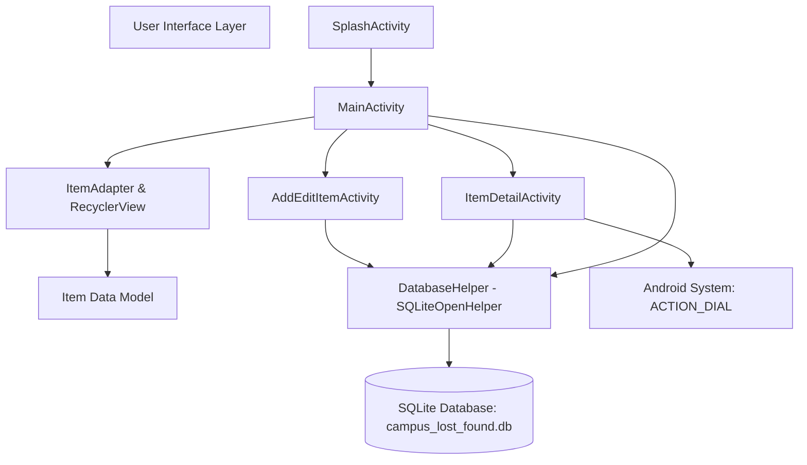
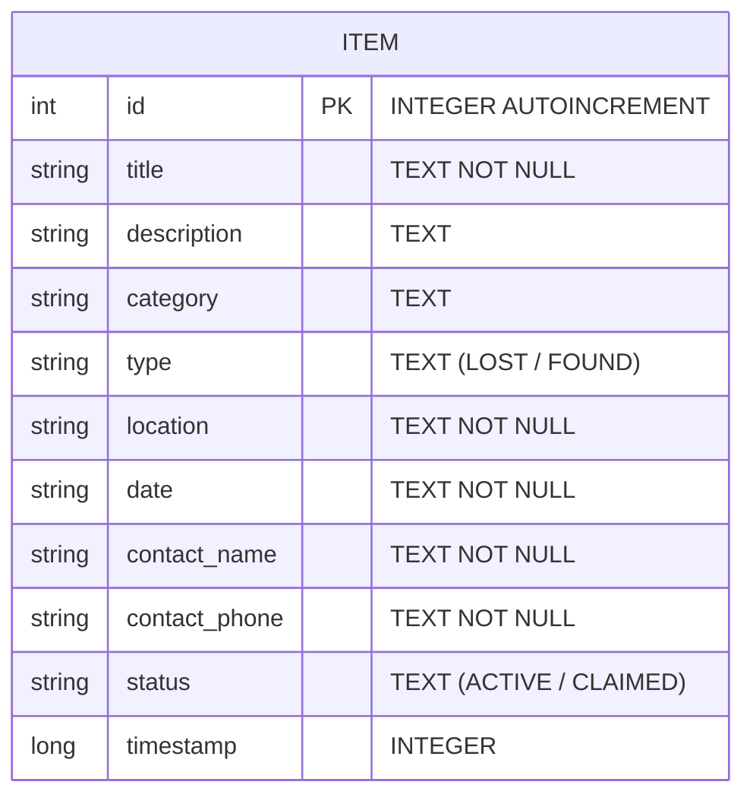
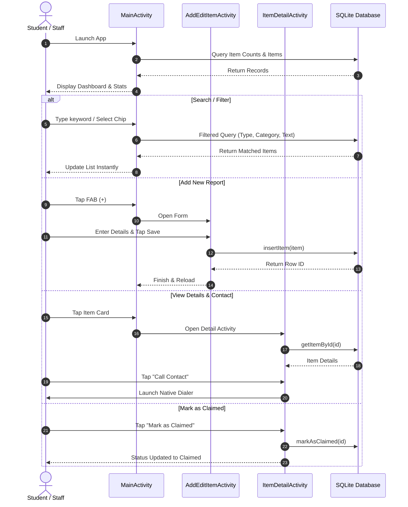

# CAMPUS LOST AND FOUND MOBILE APPLICATION
## MINI PROJECT REPORT
**Course:** Mobile Application Development Technologies (MAD)  
**Academic Year:** 2026–2027 | 7th Semester  
**Instructor:** Prof. Nayankumar Mali  

---

## 1. COVER PAGE / PROJECT DETAILS

- **Project Title:** Campus Lost and Found Mobile Application
- **Domain:** Campus Utility / Productivity / Local Data Management
- **Target Platform:** Android (API Level 24 to 34+)
- **Programming Language:** Java
- **Database:** SQLite Local Embedded Database
- **Submission Date:** October 2026

---

## 2. CERTIFICATE & DECLARATION

### Declaration
We hereby declare that the mini-project titled **"Campus Lost and Found Mobile Application"** submitted in partial fulfillment of the requirements for the course **Mobile Application Development Technologies** is an original work carried out by our team under the guidance of **Prof. Nayankumar Mali**. The content embodied in this project has not been submitted elsewhere for the award of any degree or diploma.

---

## 3. ABSTRACT

Losing valuable personal belongings such as student identity cards, scientific calculators, laptop accessories, books, or keys is a persistent problem on university campuses. Traditional mechanisms—such as posting on unofficial WhatsApp/Telegram groups or pinning paper notices on physical bulletin boards—are unstructured, rapidly lost in chat feeds, lack searchability, and fail to provide status tracking.

The **Campus Lost and Found App** is a standalone, native Android application engineered using **Java** and **SQLite** to solve this problem effectively. The application provides an intuitive platform where campus members can report misplaced or recovered items with comprehensive metadata, including item category, exact campus location, date, contact details, and descriptions. Users can filter records by status (Lost, Found, Claimed), filter by category, perform real-time instant searches, and directly contact finders via native phone dialer integration. The application requires zero internet connectivity and no cumbersome user authentication, guaranteeing 100% operational reliability, privacy, and zero server hosting overhead.

---

## 4. INTRODUCTION

Colleges and universities host thousands of students, faculty, and administrative staff moving across lecture halls, laboratories, libraries, cafeterias, and sports grounds daily. In this dynamic environment, items are routinely misplaced or left behind. 

Modern mobile applications offer the most practical medium for students to manage campus activities. This project demonstrates core Mobile Application Development principles learned in the course:
- Mobile User Interface (UI) and User Experience (UX) engineering using Google Material Components.
- Robust Model-View-Adapter architecture.
- Relational database management on mobile devices using Android's native `SQLiteOpenHelper`.
- Intent-based inter-app communication (dialing phone numbers).
- Error handling, form validation, and reactive UI state management.

---

## 5. PROBLEM STATEMENT

Misplacement of belongings on college campuses causes academic disruption, financial loss, and severe anxiety for students. The current methods utilized to recover lost items suffer from key structural defects:
1. **Unstructured Communication:** WhatsApp, Telegram, or Instagram stories get flooded with messages; notices disappear within hours.
2. **Lack of Centralization:** There is no single place where a student can check if their misplaced calculator or lab manual has been submitted.
3. **No Categorization or Search:** Finding an item requires manual scrolling through hundreds of chat messages.
4. **No Status Tracking:** Once an item is returned, notices are rarely deleted or marked as resolved, resulting in confusion and repeated inquiries.
5. **Connectivity Dependency:** Cloud-reliant apps fail in campus basement labs or during network outages.

---

## 6. OBJECTIVES

The primary objectives of the Campus Lost and Found Mobile Application are:
1. **Develop a 100% Offline Android App:** Ensure that students and security staff can log, search, and manage lost and found records without depending on cellular data or campus Wi-Fi.
2. **Implement Full CRUD Functionality:** Allow users to Create new reports, Read/browse records, Update details, Delete obsolete entries, and Mark items as Claimed.
3. **Provide Instant Search and Categorized Filtering:** Enable students to find specific items in seconds via keyword search (matching title, location, or description) and category dropdowns.
4. **Enable Direct Contact Integration:** Provide a one-tap phone dialer action using Android Intents so finders and seekers can communicate immediately.
5. **Deliver an Intuitive, Responsive UI:** Implement Material Design 3 guidelines with color-coded status badges (Red for Lost, Green for Found, Purple for Claimed) and live statistic counters.

---

## 7. LITERATURE & EXISTING SYSTEM STUDY

| Feature / Aspect | Physical Notice Boards | WhatsApp / Social Groups | Commercial Lost & Found Apps | Proposed Campus App |
| :--- | :--- | :--- | :--- | :--- |
| **Searchability** | Impossible | Poor (keyword search only within chat) | Available | **Instant real-time multi-field search** |
| **Categorization** | None | None | General | **Campus-tailored categories** |
| **Status Tracking** | None | None | Complex | **Active vs. Claimed toggle** |
| **Internet Requirement**| No | Required | Required | **Completely Offline (SQLite)** |
| **Login / Account** | N/A | Account required | Mandatory email/password | **Zero-barrier (No login needed)** |
| **Privacy & Cost** | Public exposure | Phone number exposed to group | Subscription / Ads | **Private, local, zero-cost** |

---

## 8. PROPOSED SYSTEM

The proposed system is a lightweight, high-performance native Android application. It eliminates barriers to entry by removing login requirements. Any student, professor, or campus security guard can open the app, report an item in under 30 seconds, or browse existing listings.

### Key Highlights:
- **Instant Response Time:** SQLite queries execute locally in under 10 milliseconds.
- **Visual Status Differentiation:** Instant visual clarity through distinct color cards and badges.
- **Built-in Seeding:** Automatically initializes realistic campus test records on fresh installs for demonstration and testing.

---

## 9. FUNCTIONAL & NON-FUNCTIONAL REQUIREMENTS

### 9.1 Functional Requirements (FR)
- **FR-01: Report Item (Create):** Users can submit a report by specifying Item Type (Lost/Found), Title, Category, Campus Location, Date, Description, Contact Person, and Phone Number.
- **FR-02: Browse Directory (Read):** Users can view all active and claimed records displayed inside interactive Material cards.
- **FR-03: Real-Time Search:** Real-time text filter searches dynamically across titles, descriptions, and location landmarks.
- **FR-04: Multi-Filter Engine:** Users can filter by Type (`All`, `Lost`, `Found`, `Claimed`) and by Category (*Electronics, ID Cards, Books, etc.*).
- **FR-05: Update Records (Update):** Users can edit any previously submitted report to correct details or update contact info.
- **FR-06: Resolve / Claim Status:** Users can mark an item as "Claimed", updating its badge and moving it to the resolved state.
- **FR-07: Delete Records (Delete):** Users can permanently delete an item with an AlertDialog confirmation prompt to avoid accidental deletion.
- **FR-08: Quick Dial Intent:** Tapping the contact button launches the native Android phone dialer with the phone number pre-filled.

### 9.2 Non-Functional Requirements (NFR)
- **NFR-01: Usability:** Minimal learning curve; clean single-hand navigation with Floating Action Button.
- **NFR-02: Performance:** Sub-100ms startup; instant RecyclerView scrolling with View Holder pattern.
- **NFR-03: Reliability:** Data persistence through ACID-compliant SQLite transactions.
- **NFR-04: Data Integrity:** Strict input validation on mandatory fields (title, location, contact).
- **NFR-05: Offline Availability:** Zero network permissions required; 100% functionality without internet.
- **NFR-06: Compatibility:** Compatible with Android 7.0 (Nougat, API 24) up to Android 14 (API 34).

---

## 10. TECHNOLOGY STACK & JUSTIFICATION

| Component | Choice | Justification |
| :--- | :--- | :--- |
| **Language** | Java | Standard, battle-tested language for Android education, offering explicit object-oriented architecture and lifecycle clarity. |
| **IDE** | Android Studio | Official Google IDE featuring layout inspectors, Gradle build automation, and emulator tooling. |
| **Database** | SQLite (`SQLiteOpenHelper`) | Embedded SQL engine built directly into Android OS; requires zero external server, zero configuration, and provides robust relational querying. |
| **UI Components** | Google Material Design (`com.google.android.material`) | Provides modern Material 3 aesthetic, elevated cards, choice chips, text input layouts with floating labels, and floating action buttons. |
| **Architecture** | Model-View-Adapter (MVA) | Decouples data model (`Item`), presentation layer (`Activities`), and database logic (`DatabaseHelper`). |

---

## 11. SYSTEM ARCHITECTURE

---

## 12. DATABASE DESIGN & SCHEMA

### 12.1 Entity-Relationship (ER) Diagram

### 12.2 Data Dictionary (Table: `items`)

| Column Name | Data Type | Constraints | Description |
| :--- | :--- | :--- | :--- |
| `id` | INTEGER | PRIMARY KEY, AUTOINCREMENT | Unique record identifier |
| `title` | TEXT | NOT NULL | Name/title of the item |
| `description` | TEXT | NULLABLE | Detailed description / marks |
| `category` | TEXT | NOT NULL | Category classification |
| `type` | TEXT | NOT NULL | `LOST` or `FOUND` |
| `location` | TEXT | NOT NULL | Campus location / room |
| `date` | TEXT | NOT NULL | Date in `YYYY-MM-DD` format |
| `contact_name` | TEXT | NOT NULL | Name of finder or seeker |
| `contact_phone`| TEXT | NOT NULL | Phone number for contact |
| `status` | TEXT | DEFAULT 'ACTIVE' | `ACTIVE` or `CLAIMED` |
| `timestamp` | INTEGER | NOT NULL | Unix epoch timestamp for sorting |

---

## 13. USE CASE & ACTIVITY FLOW

---

## 14. TESTING & TEST CASES

| Test ID | Test Scenario | Test Steps | Expected Result | Status |
| :--- | :--- | :--- | :--- | :--- |
| **TC-01** | App Cold Launch | Open app from app launcher | Splash screen displays for ~1.2s, sample records seed, MainActivity loads | **PASS** |
| **TC-02** | Add Item Validation | Leave Title blank and tap Save | Form rejects submission; displays "Item name is required" | **PASS** |
| **TC-03** | Insert New Lost Item | Fill all valid fields, select "LOST", tap Save | Record saved to SQLite; Toast displays success; item appears with Red badge | **PASS** |
| **TC-04** | Insert New Found Item | Fill all valid fields, select "FOUND", tap Save | Record saved to SQLite; item appears with Green badge | **PASS** |
| **TC-05** | Real-Time Search | Type "Charger" in search bar | Only items containing "Charger" in title, location, or desc are displayed | **PASS** |
| **TC-06** | Filter by Type (Lost) | Click "Lost" Chip filter | Only active and claimed items of type "LOST" are displayed | **PASS** |
| **TC-07** | Filter by Category | Select "ID Cards & Documents" in dropdown | Only ID card items are shown in RecyclerView | **PASS** |
| **TC-08** | Edit Existing Item | Click item, tap "Edit", change room to "Room 402", tap Update | Database updates record; detail screen and main list show "Room 402" | **PASS** |
| **TC-09** | Mark as Claimed | Tap "Mark as Claimed / Recovered" | Status changes to "CLAIMED", purple badge renders, Claim button disables | **PASS** |
| **TC-10** | Delete Item Confirmation | Tap Delete, click "Cancel" in dialog | Dialog dismisses; item is NOT deleted from database | **PASS** |
| **TC-11** | Delete Item Execution | Tap Delete, click "Confirm" in dialog | Record removed from SQLite; Toast displays success; returns to list | **PASS** |
| **TC-12** | Dial Phone Intent | Tap "Call Contact" on item detail | Android dialer opens with pre-populated phone number ready to call | **PASS** |

---

## 15. CHALLENGES ENCOUNTERED & SOLUTIONS

1. **Challenge:** Dynamically filtering items by type, category, and real-time search string simultaneously without lag.  
   *Solution:* Designed a flexible SQL query builder in `DatabaseHelper.getItems()` utilizing parameterized `WHERE` clauses with `LIKE` operators and SQLite indexes on `timestamp`.

2. **Challenge:** Ensuring visual differentiation between Lost, Found, and Claimed items at a glance.  
   *Solution:* Implemented custom shape drawables (`badge_lost.xml`, `badge_found.xml`, `badge_claimed.xml`) with harmonized color palettes (Coral Red, Emerald Green, Royal Purple).

3. **Challenge:** Preventing accidental data deletion.  
   *Solution:* Guarded the delete action with an `AlertDialog.Builder` modal requiring explicit confirmation.

4. **Challenge:** Making the app ready for demonstration immediately upon installation without requiring manual data entry.  
   *Solution:* Implemented `seedInitialDataIfEmpty()` in `DatabaseHelper` invoked asynchronously on splash launch, providing 4 realistic campus examples right away.

---

## 16. CONCLUSION & FUTURE SCOPE

### 16.1 Conclusion
The **Campus Lost and Found Mobile Application** successfully satisfies all requirements specified in the Mini Project guidelines. It delivers a fast, intuitive, and reliable solution to a genuine campus problem. By leveraging Java, Material Components, and SQLite, the application demonstrates robust mobile software engineering, clean architecture, and full CRUD data persistence without external server costs or authentication friction.

### 16.2 Future Scope
1. **Photo Upload Support:** Store thumbnail images of found items locally or via Android Storage Access Framework.
2. **Push Notifications:** Alert users when an item matching a previously reported lost category is submitted.
3. **Optional Firebase Cloud Sync:** Allow multi-device synchronization across campus security desks and student portals.
4. **Campus Map Pinning:** Visual pinpointing of lost/found locations on an interactive campus layout map.

---

## 17. REFERENCES

1. Google Android Developer Documentation: *SQLite Databases & SQLiteOpenHelper* (https://developer.android.com/training/data-storage/sqlite)
2. Material Design 3 Guidelines for Android (https://m3.material.io/)
3. Android Activity & Intent Architecture (https://developer.android.com/guide/components/activities/intro-activities)
4. Deitel, P., & Deitel, H. *Android for Programmers: An App-Driven Approach*, Pearson Education.
